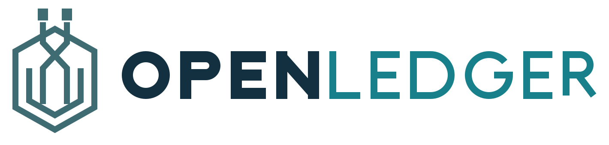

 

  

  <strong>Open infrastructure for the AI era.</strong>

  Bringing AI providers, models, and developers together through one unified platform.

  <a href="https://github.com/openledgerSI">Explore our repositories</a>
  ·
  <a href="https://github.com/openledgerSI">Join the community</a>

---

## Building a more open AI ecosystem

OpenLedger is an open-source AI infrastructure initiative focused on making artificial intelligence more accessible, interoperable, and easier to work with.

As the AI ecosystem grows across providers, models, and services, developers need a simpler way to access, manage, and build with these capabilities.

OpenLedger aims to bring that experience together through a unified platform designed around openness, flexibility, and developer freedom.

**One platform. Multiple providers. Limitless possibilities.**

## Our vision

We envision an AI ecosystem where developers can work across providers and models without unnecessary complexity or fragmentation.

OpenLedger is being built to help make that possible through:

- **Unified AI access** — A consistent way to work with multiple AI providers and models.
- **Intelligent routing** — More flexible ways to select models based on cost, performance, and availability.
- **Usage transparency** — Clear visibility into consumption, usage, and costs.
- **Developer freedom** — Flexible tools and workflows that adapt to different needs.
- **Open infrastructure** — An ecosystem designed to support both self-hosted and managed experiences.
- **Flexible payments** — A vision for accessible, transparent usage and billing options.

## Built around openness

We believe the future of AI infrastructure should be:

- Open and accessible.
- Flexible across providers and models.
- Transparent in usage and costs.
- Designed with developers in mind.
- Community-driven and continuously evolving.

## Follow the journey

OpenLedger is in early development, and we're laying the foundations for the platform step by step.

We welcome developers, builders, researchers, and open-source enthusiasts who share an interest in making AI infrastructure more open and accessible.

- Explore our [GitHub repositories](https://github.com/openledgerSI).
- Follow our development.
- Share feedback and ideas.
- Contribute to the ecosystem.

## A more open future for AI

The AI ecosystem should not be limited by fragmented tools, disconnected providers, or unnecessary complexity.

We're building toward a future where AI infrastructure is more unified, transparent, and accessible to everyone.

  <strong>OpenLedger</strong> 
  Open infrastructure. Unified intelligence.

---

  An independent open-source initiative. All third-party names and trademarks belong to their respective owners.

